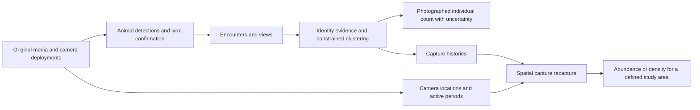

# Project assessment for a Risnjak lynx monitoring collaboration

Assessment date: **14 October 2026**. Target clarified by the user during this assessment: **Risnjak National Park, initially counting Eurasian lynx because of their distinctive markings**.

**The project has a substantial research and evaluation foundation, but reliable lynx clustering and individual counting remain research outcomes to achieve.** It is credible as the basis for a joint feasibility study. Its current results do not qualify it as an operational animal population monitoring system. The most useful next investment is a validated chain from encounters to identities to counts, supported by expert evidence and measured review effort.

The existing requirement remains binding: reliable clustering and defensible assessment of the number of photographed individuals are required demo outcomes. A list of candidate matches is useful evidence for that outcome, but does not complete it. Total abundance in a study area requires a further ecological model and a suitable survey design.

**Evidence and scope**

This assessment combines static source inspection, read-only analysis of saved artifacts, limited inspection of saved correspondence images, the thesis and previous audits, and current primary-source research. No tests, training, model inference, benchmark execution or outreach were performed. Existing user changes were preserved. Documentation is the only project material changed for this assessment.

The Git HEAD inspected was `c63d533a`, dated 27 June 2026. The working tree also contains later modified files and untracked benchmark modules, tests and research documents. Consequently, HEAD alone does not identify the assessed implementation. The [accompanying evidence receipt](project-risnjak-assessment-2026-10-14.json) records selected current file hashes and saved result references.

Historical test evidence is 302 passing tests recorded in the September readiness assessment and 106 focused tests reported by the user for phase 2. These are historical receipts, not a fresh test run. Many model paths use mocks. The current RoMa manifest and all nine source hashes it records were checked; they agree with the inspected files. Its focused-test confirmation remains unrecorded in the inspected notes.

**What has actually been built**

There are three related systems in the repository. They share methods, but their interfaces and evidence differ.

| Part | Existing functionality | Practical interpretation |
| --- | --- | --- |
| Thesis pipeline | Optional tone mapping/segmentation; local feature extraction; PCA/GMM Fisher vectors; global retrieval; calibrated late fusion; geometric reranking; HITL-NIS counting experiments | A reusable research implementation. The thesis recognition tables largely concern closed-set identification. Counting uses simulated identity judgments. |
| `reid_demo` workflow | SQLite detection records; ingestion and animal crops; species filtering; embeddings; multiple clustering backends; HTML catalogues; review decisions; evaluation; bundle assembly | Considerable pilot scaffolding. Multi-camera integrity, stable identities, incremental processing and reliable lynx grouping still need work. |
| CzechLynx benchmark | Real-image importer; provided masks; pinned MiewID; fitting/calibration/selection partitions; artifact contracts; unknown rejection; subgroup reports; RoMa/DISK pair diagnostics | The strongest current evaluation foundation. It does not yet demonstrate an integrated raw-camera-to-count system on Croatian data. |

The project already has several useful strengths: reproducible input membership, separate fitting and calibration roles, model and cache fingerprints, evidence for skipped or failed local verification, same-input comparisons, and explicit reporting of unknown animals. These make experiments much easier to interpret and reuse. The evaluation foundation is materially more advanced than the field workflow.

“Species agnostic” describes a modular architecture, not established equal performance across species. “No labels” is too broad for the demonstrated system: pretrained models use supervised identities, calibration uses labels, CzechLynx supplies expert identity annotations and masks, and the counting CLI accesses ground truth. A practical description is **transferable visual matching with a small, explicitly measured amount of expert supervision**.

The saved MegaDescriptor scratch runs contain best/last checkpoints, including older 384-dimensional configurations. Checkpoint presence is not evidence of a better lynx model. Preserve the existing distinction between the native 1536-dimensional architecture and a 384-dimensional projection ablation. No Croatian or independent lynx advantage for those checkpoints was established in this assessment.

**The three quantities a park might want**

| Quantity | Example of the question it answers | What is needed |
| --- | --- | --- |
| Observations and encounters | How often did cameras record lynx during this survey? | Valid detections, species confirmation, source provenance, encounter grouping and camera effort. |
| Unique photographed individuals | How many different lynx are represented in this defined collection and time window? | Reliable identity assignment or a validated statistical count estimator; opposite-flank linkage; explicit unresolved cases. |
| Population abundance or density | How many lynx use a defined study area, including animals never photographed? | Capture histories, deployment locations and active periods, sufficient recaptures, a defined population/window, and capture–recapture modelling. |

An animal photographed in Risnjak may also use surrounding land. A catalogue accumulated over years measures animals observed over those years; it does not measure the number simultaneously present or resident. Cubs, independent animals, visitors and seasonal turnover also need an agreed definition. The project should initially answer the second question, while preserving data needed for the third.

**What the saved lynx results establish**

The strongest completed phase 2 reference uses frozen segmented MiewID-msv3, a frozen calibration threshold, and identities separated from local fitting and calibration. This remains development selection, rather than final independent field validation.

| Phase 2 selection measure | Saved result | Implication |
| --- | --- | --- |
| Correct first match for known queries | 562/881 = **63.79%** | Useful retrieval signal, with substantial identification error. |
| Correct identity in first five images | 699/881 = **79.34%** | A short candidate list may support expert work; actual usability remains unmeasured. |
| Correct identity in first fifty images | 822/881 = **93.30%** | Many errors leave room for better ranking; 59 known queries still lack a correct returned reference. |
| Mean top-1 across identities | **47.28%** | Frequently photographed animals make the image-weighted headline more favourable. |
| Correct accepted assignments / all accepted | 325/383 = **84.86%** | **58 accepted assignments are wrong:** 12 known-animal errors and 46 unknown-animal errors. |
| Correct accepted known queries / all known queries | 325/881 = **36.89%** | The frozen rule does not combine high reliability with high coverage. |
| Unknown image false-accept rate | 46/1,455 = **3.16%** | A low image-weighted rate does not establish reliable unknown discovery. |
| Mean false-accept rate across unknown identities | **17.77%** | Some rarely photographed unknown animals are poorly handled; small samples remain imprecise. |
| Other-camera-only top-1 | 76/155 = **49.03%** | Cross-camera matching is a meaningful weakness. |
| Opposite-appearance-only top-1 | 1/5, one identity | Too little evidence to qualify day/night robustness. |

Source: [selection review and receipt](czechlynx-phase2-selection-results-2026-09-16.md), backed by `evaluations/czechlynx/phase2_selection_miewid_global/metrics.json` and saved predictions. Colour and near-monochrome groups are appearance proxies, not verified day/night/infrared categories.

The historical 303-known-query comparison is a different protocol. Global, global+Fisher and full-funnel top-1 were respectively **156, 155 and 153 correct**. Adding local processing did not improve overall first-match accuracy in that comparison. It did change individual answers: GV fixed 16 and broke 18. This is evidence about that configuration and collection, not evidence that local features are universally ineffective or proof of pretraining leakage.

The corresponding clustering diagnostic is more directly relevant to the user's goal. On 560 query images representing **60 individuals**, the full funnel produced **eight clusters**, all mixed, with **7.42% pair precision**, **39.14% pair recall**, **ARI 0.0863**, and no unassigned images. All available evidence was forced into a poor grouping. Global-only grouping produced six clusters, also unsuitable. These are historical Louvain-based diagnostics, not evidence that every possible clustering method will fail. They establish that the current demonstrated grouping is unusable for counts. [Historical full-pipeline review](czechlynx-miewid-full-pipeline-results-2026-09-13.md).

The earlier cow assessment illustrates another failure mode: 18 groups for 12 animals despite ARI approximately 0.70. Recognition can be strong while identities fragment. Cluster purity can be made excellent by placing every photo in its own group. A count can also accidentally be correct because false merges and false splits cancel. Counts, pair precision/recall, fragmentation, and unresolved coverage must therefore be assessed together. [Pilot readiness assessment](../pilot-readiness-2026-09-10.md).

**Upstream exposure remains unresolved**

Local fitting/calibration/selection separation is well documented. It cannot establish whether MiewID previously saw the same photographs, the same lynx in other photographs, or inherited representations trained on those individuals. Prior exposure to the species itself is a separate, expected property of a specialist model.

The earlier provenance audit identifies the exact v3 checkpoint and matching publisher artifact, explicit lynx training in v2, earlier private Czech collections, and pre-v3 Croatian uploads to Whiskerbook. None establish the exact v3 overlap. Croatian institutional origin alone does not guarantee an independent test.

The 1,614 later-dated Czech photographs across 13 identities remain potentially useful for a locked temporal evaluation if acquisition dates are verified. They are in the official time_open test partition. Novel photographs do not establish novel animals. No new publisher correspondence was available during this assessment. [Existing provenance audit](miewid-czechlynx-training-provenance-2026-09-13.md).

For a Risnjak study, document prior platform uploads and data sharing, freeze exact weights before prospective collection, and distinguish performance on new photographs from performance on independently unseen individuals. Unknown provenance should remain visible while permitted method development continues.

**What the completed RoMa experiment adds**

The saved run is complete with zero matcher errors. Its 2,000 result rows cover the same **1,000 query–gallery pairs for each matcher**, from 100 stratified calibration queries. Each matcher sees 247 same-identity pairs and 753 different-identity pairs. Of 68 known queries, only 52 have a correct identity in the top-ten shortlist; pair verification cannot recover the other 16.

| Saved diagnostic | DISK + LightGlue | RoMa |
| --- | --- | --- |
| Inlier-count ROC AUC | **0.696** | **0.446** |
| Inlier-fraction ROC AUC | **0.343** | **0.444** |
| Foreground coverage ROC AUC | **0.634** | **0.609** |
| Median inliers, same / different identity | **6 / 5** | **96 / 101** |
| Median uncached pair seconds | **0.0263** | **0.6837** |

These AUCs describe pair discrimination in a selected, correlated calibration sample. They are not a held-out ranking comparison, and do not measure the additional value of a learned combination with global similarity. Timing excludes model initialization and DISK feature pre-extraction; it is not a complete pipeline cost comparison. The result does not justify promoting RoMa into the count pipeline under the existing evidence rule.

Four saved correspondence images were inspected: both matchers on the first preselected true rank-1 pair, and both on the first preselected false rank-1 pair. RoMa gives many anatomical/silhouette correspondences in both. The false pair has 97 homography inliers, while the true pair has 80. DISK gives 16 and four respectively. This limited visual inspection illustrates why successful homography estimation and identity verification have different meanings. It does not establish how often anatomy, masks or deformation explain failures across all pairs.

Saved [diagnostic report](../../evaluations/czechlynx/roma_pairwise_calibration/index.html), [summary](../../evaluations/czechlynx/roma_pairwise_calibration/summary.json), and [experiment contract](../czechlynx-roma-pairwise.md). Full visual and per-identity evidence review remains open.

**Why local-feature improvement may be missing**

There are several concrete mechanisms worth testing. Their presence in the design is established; their contribution to the observed errors is not.

1. **Score fusion has different implementations.** The thesis fits calibrators. The CzechLynx benchmark's `rank_queries` averages clipped global/Fisher cosines and uses `-inliers * log(1 - base_score)` for attempted GV reranking. The demo affinity code can load calibrators but falls back to clipped raw cosine. An average of raw scores is not automatically a calibrated identity probability. Establish a shared, role-bound scoring contract and compare it against the existing controls.

2. **Geometry measures something broader than coat identity.** A homography models a planar/projective relationship, while a moving animal bends, changes viewpoint and reveals different surfaces. Dense matching can align similar anatomy on different animals. The minimum is four correspondences, enough to fit a homography without redundant support. Normalization uses the selected point cloud rather than a fixed image coordinate scale. Compare well-spread, redundant matches on identity-bearing regions, reprojection diagnostics and simpler local geometric models. Preserve identical candidate pairs during these controls.

3. **Masking keypoint centres does not isolate descriptor support.** Descriptors near boundaries can still encode silhouette or background; dense patches can carry animal shape rather than distinct spots. Audit ROI support, mask quality and coordinate transforms, including the legacy LightGlue convention that omits explicit image size. This assessment did not establish a coordinate bug.

4. **The ensemble combines independently fitted coordinate spaces.** `combine_fisher_matrices` sums equal-shaped vectors from separate extractors and then normalizes. Separate PCA/GMM axes and component order have no necessary correspondence. The resulting dot product contains cross-extractor terms. Compare per-extractor score fusion or concatenated, normalized blocks against that weighted sum. This is an architectural ablation, not an identified cause of the current failure.

5. **The correct animal must reach local verification.** Top-ten reranking and repeated gallery images can leave the correct identity outside the reviewed head. Evaluate identity-diverse candidate lists, union recall and ROI matching before spending more on a matcher.

6. **Generic matching training is not identity training.** DISK was designed around learning repeatable feature matches with geometric supervision for image matching and reconstruction. Animal identity under deformation and lighting change is a different target. A larger generic correspondence model may improve correspondence density without improving identity discrimination. [Local DISK paper](../papers/disk.pdf).

Useful diagnostic evidence would classify errors into shortlist misses, weak genuine coat evidence, false anatomical alignment, poor geometry, harmful score fusion and genuinely ambiguous photographs. Add hypotheses only after inspecting pairs from distinct animals, encounters, cameras and appearance groups.

**Engineering issues before a multi-camera pilot**

The first two items below were reproduced in the September readiness assessment. The additional items are static findings from the current inspection; they were not reproduced by executing tests this turn.

| Finding | Current evidence | Needed behaviour |
| --- | --- | --- |
| Filename collisions | `ingest.py` takes `Path(file).name`; `store.make_record_id` uses stem plus crop index | Stable identifiers scoped to collection/deployment/source, full provenance, explicit duplicate detection. |
| Re-ingestion resets downstream state | Store upserts refresh all non-key columns, including incoming default review/embedding/cluster values | Stage-owned updates, preservation of reviews, explicit invalidation when media or processing changes. |
| Stage completion checks any output row | `_store_stage_done` returns true after finding one non-null output | Process every eligible pending record; completeness tied to the intended batch/configuration. |
| Fused reruns bypass review protection | `plan_stages` requests `force=True` for the second clustering pass; clustering then includes reviewed rows | Recompute proposals separately from confirmed identities; explicit handling of approved corrections. |
| New labels can collide with reviewed labels | Non-forced clustering excludes reviewed records; fresh labels start at zero; writes use the same dataset namespace | Persistent identity IDs distinct from temporary cluster labels; reserve/remap labels and support explicit identity attachment. |
| Cache skips use output presence | `embed_records(only_missing=True)` skips any row with an embedding reference | Validate requested model/input versions before reuse; distinguish pending, valid, stale and failed outputs. |
| MiewID is confined to the benchmark adapter | Demo embedding delegates to `global_embedding`, supporting MegaDescriptor/ResNet; conductor does not forward a model choice | Connect the qualified lynx model and its preprocessing/provenance contract to field ingestion. |
| Benchmark segmentation is annotation assisted | CzechLynx supplied masks drive the main segmented runs; no lynx entry in the Grounded SAM2 dataset prompt registry | Evaluate predicted crops/masks on raw lynx footage, with traceable failures and retained originals. |
| Review queue is narrow | It checks uncertain records against their current cluster; singletons have no candidate reference | Search across candidate identities, review suspected false merges and splits, and offer genuine unresolved decisions. |
| Dense affinities limit scale | Clustering/fusion construct square pair matrices, including float64 intermediates | Encounter compression, sparse neighbour retrieval and bounded pair verification for larger archives. |

These are consequences of a research/demo design being used for a persistent workflow. They should be addressed before ingesting a valuable partner archive into a mutable shared database. Fixes need concrete proposals and user approval under the repository instructions.

The new-label concern is especially easy to miss: preserving the old rows does not preserve identity meaning if a newly computed label `0` is also the ID of an existing reviewed animal. Likewise, an unchanged `review_status` does not protect an assignment that a forced rerun overwrites.

For scale context, one 50,000 by 50,000 float64 matrix alone uses 20 GB in decimal units; current transformations can retain multiple such objects. A small lynx pilot should initially operate on encounter representatives. Sparse candidate retrieval can follow when actual archive volume warrants it.

There is a basic local browser review interface, not a demonstrated multi-user service. No root project licence or deployment packaging/CI configuration was found in the inspected file inventory. Requirements include unpinned Git dependencies and platform-specific GPU packages. A reproducible deployment environment, model licences, backups, access controls and data export should be scoped before handing the system to a park. A researcher-operated local pilot can precede a hosted service.

**Risnjak is a relevant target, with an existing research landscape**

Risnjak's own site identifies Eurasian lynx as an important species of the park and surrounding forests. This establishes ecological relevance, but gives no verified inventory of its current camera archive, experts, budgets or data access. Its older species-page population claims should not be treated as a current census. [Official Risnjak mammals page](https://www.np-risnjak.hr/en/mammals/).

A particularly relevant Croatian study is Blašković, Sindičić, Reilly, Topličanec and Gomerčić, *Spotted correctly? Human expertise remains essential in AI-assisted identification of Eurasian lynx*. The author-associated CroRIS record reports MiewID matching 64.0% of encounters versus 45.5% for HotSpotter, and expert-operated MiewID identification at 71.7% versus 92.7% for experienced manual identification. Photo quality mattered; AI performed better on black-and-white images in that study. These are different methods/denominators from this repository's results. The publisher scrape failed; the accessible abstract supports these observations, while full methods were not reviewed. [CroRIS paper record](https://www.croris.hr/crosbi/publikacija/prilog-casopis/916070).

This makes the University of Zagreb Veterinary Faculty lynx research team a particularly relevant prospective scientific partner, alongside Risnjak's conservation/research staff. A useful opening is to discuss their current identity catalogue, difficult matching cases, deployment records and acceptance criteria. Their experience and data access are not assumed to be available.

Regional monitoring already combines photography with ecology. A 2025 Dinaric restoration study used camera trapping and spatial capture–recapture across Slovenia and Croatia, with defined seasonal windows for demographic closure and coordinated monitoring. This supports integrating identity evidence with existing monitoring methods. It does not establish readiness of this code. [Regional monitoring study](https://pmc.ncbi.nlm.nih.gov/articles/PMC12104966/).

Plitvice is a relevant second partner example: its official account describes 123 historical camera locations, 26 different lynx observed over 2014–2022, and seven observed in 2022. The distinction between cumulative individuals and a single year's observations is useful for defining the Risnjak output. These are historical figures, not current abundance. [Official Plitvice lynx monitoring account](https://np-plitvicka-jezera.hr/ris/).

Established Wildbook/Whiskerbook workflows already support individual matching. Compare the project with the partner's existing tools and manual workflow. Potential value lies in locally validated clustering/counts, auditable uncertainty, useful integration and reduced review effort. Replacing their catalogue software is not an assumed requirement. [Wild Me's lynx platform description](https://www.wildme.org/wildbook-for-lynx.html).

**Recent avenues worth pursuing**

Two current developments materially update the earlier roadmap.

Wild Me has announced MiewID v4, with more training data and reported improvements for Eurasian lynx on its own evaluation. Availability of a suitable exact checkpoint, permissions, source inventory and independent comparison remains to be established. Treat it as a candidate for controlled evaluation, preserving v3 as the reference. A publisher's improvement is not an expected percentage increase on Risnjak. [Publisher announcement](https://community.wildme.org/t/miewid-v4-announcement/5406).

AnimalCLEF 2026 shifted toward individual discovery through clustering. A July 2026 participant paper describes global retrieval, LightGlue features, learned pair scores and conservative graph construction; it reports aggregate private ARI 0.674 across four species. Its lynx analyses also show sensitivity to graph settings. This is a directly relevant design reference, not a comparable lynx accuracy claim or proof of independent Croatian performance. The official overview's species list differs from the participant paper, so use the paper for that submission's lynx-specific account. [Official task](https://www.imageclef.org/AnimalCLEF2026), [participant paper and code link](https://arxiv.org/html/2607.16453v1).

Background control should also be more precise than indiscriminate removal. Picek and colleagues separate foreground recognition from explicit spatial/temporal priors. This supports testing recognition and ecological context separately, with careful camera-transfer evaluation and no use of held-out identities to fit priors. [Foreground/background modelling paper](https://arxiv.org/html/2408.12930v1).

**Recommended improvement sequence**

**1. Establish safe data and persistent identity semantics.** Fix scoped IDs, repeated ingestion, partial batches and reviewed-state protection. Store original media and deployment provenance. Give confirmed biological identities stable IDs; version cluster proposals and retain an append-only decision history. Changes in processing should invalidate relevant derived evidence, not silently reset expert conclusions.

**2. Define an independent Risnjak evaluation.** Request a bounded retrospective archive with expert identities where available, representative difficult cases and missing/unidentifiable media. Keep a frozen evaluation collection separate from model development. Use identity/encounter grouping, prior-sharing checks, and camera/temporal transfer tests. Report how expert truth was established and adjudicate ambiguous cases instead of forcing a label. Evaluate the raw detection/species/segmentation chain as well as selected lynx crops.

**3. Make encounters the working unit.** Several consecutive frames often offer views of one animal but very little independent evaluation evidence. Build encounter representatives and combine high-quality images from the same verified track. Retain frames showing different body parts. Mixed-animal encounters cannot be assigned one identity automatically. Correct clock synchronization and source video/burst membership are more defensible than a generic fixed time-gap rule.

**4. Handle viewpoints explicitly.** Left and right flanks have different spot patterns. Maintain view-specific evidence attached to a common biological identity only when a synchronized camera pair, a continuous unambiguous track, trusted catalogue or other independent evidence links them. A mirrored crop does not reveal the hidden flank. Where opposite sides remain unlinked, propagate that uncertainty into counts. Learn orientation and identify usable regions; do not count left/right catalogue entries separately by default.

**5. Learn and validate pair evidence before changing clustering heuristics.** Keep frozen MiewID as the control. Audit local geometry and ROI support, compare separate DISK/ALIKED signals, and evaluate Fisher score fusion against vector summation. Fit a simple joint scoring/calibration model on permitted development pairs, using hard negatives and encounter-balanced positives. Validate at the high-precision operating points needed for edges, including missing local evidence and genuine zero-match cases. Include identity-diverse retrieval and reject uncertain unknowns.

**6. Build a conservative graph with unresolved cases.** A k-nearest-neighbour graph connects each photo to neighbours whether convincing matches exist or not. Threshold edge admission, examine agreement across multiple independent encounters, and use expert same/different constraints. Audit weak edges that join large components and perform identity attachment separately from discovery. Require cluster consistency, not a single strong link. A real singleton remains a plausible observed animal; an unidentifiable image remains unresolved. Those meanings should not be collapsed into a universal candidate-new flag.

**7. Treat night/infrared as an evaluation dimension.** Establish audited day/IR/white-flash/unknown labels using actual evidence. Evaluate day–day, IR–IR and day–IR pairs separately, with identity and encounter denominators. Test grayscale consistently, modest contrast normalization, camera-aware augmentation, region crops and encounter aggregation. If needed, fine-tune with genuine cross-condition positives. Image processing cannot recover absent coat detail, and synthetic enhancement must not invent identifying spots. Do not discard night images or count day/night groups as different animals.

**8. Improve the backbone with targeted supervision.** Compare pinned model candidates first, then fine-tune the most promising representation on permitted lynx identities. Use balanced identities and diverse encounters, hard negatives, and actual camera/lighting variation. The existing MegaDescriptor trainer is reusable infrastructure; new MiewID training support would require separate implementation. Small adapters or later-layer fine-tuning can be evaluated before large training runs. Weak clusters should not become self-training labels; early false merges can reinforce themselves.

**9. Validate count uncertainty, including the NIS path.** Cluster-based counts need false-merge and fragmentation measurements, unresolved-case accounting and review time. NIS is a separate valuable research option when counting without completing every identity assignment saves effort. Its callback supports pair queries, but the CLI currently requires ground-truth identities, and the practical human workflow is missing. Develop it as an additional count check while fulfilling the clustering requirement.

**10. Produce capture histories for ecological inference.** Export individual × station × occasion observations, deployment coordinates, active intervals and downtime. With an ecologist, select a spatial capture–recapture model, survey window and habitat/state space. Include identity-error sensitivity and age/sex definitions. A small park may need a surrounding camera network to represent animals whose ranges cross its boundary. Sufficient spatial recaptures and sampling design determine identifiability; adding a statistical package alone does not create that evidence.

**A statistical qualification for the existing NIS code**

With a perfect binary oracle and positive proposal support, the inner importance estimator of degree is unbiased. The implemented outer contribution uses its reciprocal:

\[
\widehat K=\frac1N\sum_i\frac{1}{Q(u_i)}\frac{1}{1+\widehat d(u_i)}.
\]

The function `1/(1+d)` is convex for nonnegative degree. Therefore finite inner-sample variability creates an upward bias even when the degree estimate is unbiased. Increasing the number of outer samples can narrow the interval around a still-biased value. This is a mathematical property of the inspected estimator, not a newly measured benchmark defect. The original method explicitly describes asymptotic unbiasedness and finite-inner-sample bias. The thesis's unqualified “unbiased” language should be qualified in future reporting. [Original method](https://arxiv.org/html/2312.05287v2).

The returned standard error estimates variability across sampled contributions. It does not include erroneous human judgments, uncertain identities, detection omissions or ecological non-detection. The default outer budget is small, and confidence-interval coverage needs empirical qualification. Tiny proposal support can also produce rare large importance weights. Measure budget convergence and interval coverage on independent labelled collections before operational use.

Repeated positive confirmation is evaluated with independent simulated label flips. A real expert may repeat the same systematic mistake on the same ambiguous pair. Independent adjudication, documented uncertainty and realistic error analysis are more meaningful than assuming repeated clicks provide independent protection. Photographic identification errors can propagate into capture histories and abundance estimates. [Identification-error study](https://pmc.ncbi.nlm.nih.gov/articles/PMC7156508/).

**A concrete Risnjak feasibility collaboration**

The first deliverable should be an independently assessed **lynx identity catalogue and photographed-individual count for one agreed collection and monitoring window**. Suggested supporting outputs are encounter tables, evidence for each proposed merge, view linkage, unresolved images, count sensitivity and reviewer effort. A capture-history export is a bridge to subsequent abundance work.

Data requirements should be discussed with both park staff and the scientific monitoring team:

- Original photographs/videos and source camera/deployment IDs, rather than only selected attractive images.
- Timestamps and any known clock corrections; burst/video/encounter membership.
- Existing identity catalogue, flank annotations, paired-camera relationships and expert confidence where available.
- Representative poor imagery and a sample from all incoming media to estimate missed lynx detections and mistaken exclusions.
- Prior sharing/upload history, access terms and permitted model-training use.
- For abundance work: station coordinates, deployment active periods, downtime, survey design and the relevant study-area definition.

Exact locations can remain with the partner during an initial recognition study. Useful outputs should fit their current tables and catalogue. Camtrap DP provides a standard separation between deployments, media and observations; it is a sensible exchange target to investigate, not a required replacement for the internal store. [Camtrap DP specification](https://camtrap-dp.tdwg.org/).

A possible unsent discussion description is:

> I am developing a camera-trap analysis pipeline and would like to validate it with Risnjak and a lynx monitoring researcher. The first study would test whether it can group your photographs into reliable individual identities and estimate how many different lynx were photographed during an agreed period, with explicit uncertainty and measured expert review effort. We would compare it with your existing identification process and preserve the data needed for later capture–recapture analysis.

This proposes research and concrete outputs. It does not claim that those outputs are already reliable. No contact was made during this assessment.

**Acceptance gates to agree before evaluation**

No numerical count tolerance or review burden has been approved. The following are proposed measurement requirements.

| Gate | Evidence needed |
| --- | --- |
| Data integrity | No cross-camera collisions; safe retries; partial-batch completion; reviewed decisions and identity meaning preserved across reruns. |
| End-to-end coverage | Measured missed lynx, false exclusions and unprocessable media, including poor/night images. |
| Identity edges | Precision/recall on realistic hard candidate pairs, with uncertainty and encounter/identity denominators. |
| Clusters | False merges, fragmentation, pair precision/recall, ARI and coverage; review-based corrections reported separately from initial automation. |
| Individual count | Absolute and relative error, uncertainty, opposite-view treatment, unresolved cases, and stability across cameras/windows. |
| Human effort | Review minutes and decisions per encounter/collection; agreement and adjudication; comparison with the current workflow. |
| Transfer | Frozen evaluation on new media/cameras and appropriately independent animals; upstream exposure status stated explicitly. |
| Abundance | Suitable survey/recaptures, deployment effort, defined area/window and qualified ecological model. |

For a small lynx population, an error of one individual may matter more than a generic percentage target. Agree the acceptable absolute count error and uncertainty first. A 99% observed match precision from a tiny sample is weak evidence: even zero errors in 300 independent accepted decisions only gives roughly a 1% one-sided 95% upper error bound. Burst frames do not provide 300 independent trials, and edge precision still does not by itself guarantee a correct count.

**How close the project is**

| Outcome | Present assessment |
| --- | --- |
| A technically credible discussion with Risnjak/researchers | Feasible now using the documented prototype, results and a clear validation proposal. |
| A retrospective feasibility study | Achievable after integrity fixes, model integration, an agreed archive and expert reference data. |
| A demonstration satisfying the required clustering/count outcome | Open. Requires substantially better grouping or a qualified combination of automated grouping, count estimation and acceptable expert review. |
| Routine photographed-individual monitoring | Requires successful independent validation and stable incremental identity management. |
| Defensible abundance/density monitoring | Requires the additional ecological layer and a suitable camera survey. |
| A park-operated hosted service | Requires packaging, operational support, access controls, backups and workflow qualification. |

A reasonable planning scenario for one developer with responsive collaborators is several weeks for focused integrity/integration work, followed by several months of empirical development and retrospective validation. A prospective abundance study may require a monitoring season. These are planning judgments, not delivery promises: data availability, expert capacity, identity ambiguity and cross-condition recognition can determine the schedule. There is no defensible “percentage complete” for field reliability.

The next concrete proposals should cover **data integrity and stable identity state**, then **encounter/view-aware evaluation and conservative clustering/count validation**. Calibrated local/global evidence and night/IR improvements should be evaluated within that outcome, preserving the completed phase 2 reference. Approval for new code and user-run validation remain separate from this assessment.

For broader Croatian use, the same ingestion/provenance layer could support species occurrence and activity studies. Unmarked boar, roe deer and wolves need different identification evidence or ecological sampling methods; reliable visual individuality cannot be inferred from a successful lynx pipeline. Bear faces and other biometrics are possible specialist projects. The first collaboration should therefore remain one species, one clearly defined outcome and one validation protocol.
